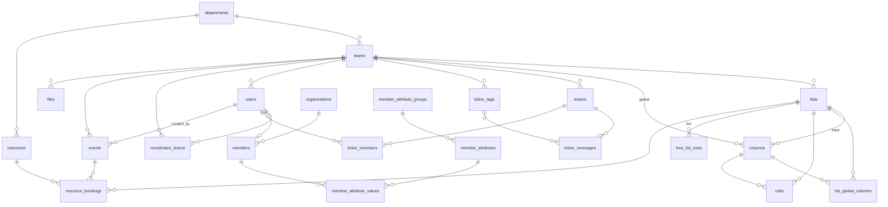

# Team Manager

Mobile-first Webanwendung zur Verwaltung von Sportteams. Koordinatoren legen Listen mit frei definierbaren Spalten an, Mitglieder tragen ihre eigenen Daten ein, und eine Statistikseite fasst die Kennzahlen pro Mitglied zusammen.

Dazu Termine und Serien, Ressourcen (Plätze, Hallen, Busse) mit Auslastung, Kalender-Abos,
Live-Ticker, Benachrichtigungen per E-Mail oder Push und ein Gastbereich ohne Anmeldung.
**Was die App genau tut, steht in [SPEC.md](SPEC.md).** Diese README beschreibt Einrichtung,
Betrieb und Mitarbeit.

**Stack:** PHP 8.3 · PostgreSQL 15 · Bootstrap 5 · kein Framework

---

## Datenmodell

Die Anwendung gliedert sich in fünf Bereiche: Teamverwaltung (Abteilungen, Teams, Koordinatoren), Inhalte (Listen/Spalten/Zellen als EAV, Dokumente, Termine), Ressourcen, Live-Ticker und Mitgliedsprofile (mit Organisationen). Das Diagramm zeigt die wichtigsten Tabellen; die vollständige Liste steht in `CLAUDE.md`.



| Relation | Beschreibung |
|----------|-------------|
| `teams → users` | Ein Team hat mehrere Koordinatoren und Mitglieder; `users.team_id` gibt das Ursprungsteam an. |
| `teams → coordinator_teams ← users` | Koordinatoren können mehreren Teams zugeordnet sein; `coordinator_teams` ist die Wahrheitsquelle für aktive Zugehörigkeiten. |
| `users → members` | Jeder Benutzeraccount ist mit einem dauerhaften Mitgliedsprofil verknüpft, das teamübergreifend gültig ist. |
| `departments → teams / resources` | Eine Abteilung (z. B. Fußball, Tennis) gruppiert Teams und Ressourcen; beides gehört zu genau einer Abteilung. Ein Team sieht nur die Ressourcen seiner Abteilung. Mitglieder und Organisationen gehören zu keiner Abteilung. |
| `organizations → members` | Eine Organisation (z. B. ein Verein) bündelt Mitglieder; ein Mitglied gehört optional zu genau einer Organisation. Auch Koordinatoren haben eine Organisation. |
| `teams → lists` | Ein Team verwaltet beliebig viele Listen (z. B. Trainings, Spiele). |
| `lists → columns (lokal)` | Lokale Spalten (`columns.list_id IS NOT NULL`) gehören ausschließlich zu einer Liste und können vom Typ Text, Zahl oder Ja/Nein sein. |
| `teams → columns (global)` | Globale Spalten (`list_id IS NULL`) stehen teamweit zur Verfügung; Systemspalten (`team_id IS NULL`, `is_system = TRUE`) gelten für alle Teams. |
| `list_global_columns` | Steuert, welche globalen/System-Spalten in welcher Liste aktiv sind; Entfernen löscht die zugehörigen Zellen. |
| `lists + columns → cells` | Speichert EAV-Werte: eine Zeile pro (Liste, Spalte, Mitglied); der Wert wird als `TEXT` abgelegt und per `data_type` interpretiert. |
| `lists → free_list_rows` | Freie Listen haben eigene, frei benannte Zeilen statt Mitgliedern; ihre Zellen hängen an `free_list_rows.id`. |
| `teams → events` | Termine eines Teams (ohne Spalten). `created_by` merkt, wer ihn angelegt hat; Mitglieder dürfen das nur, wenn `teams.members_create_events` gesetzt ist. |
| `teams → files` | Markdown-Dokumente eines Teams. |
| `resources → resource_bookings ← lists / events` | Ressourcen pflegt der Admin für alle Teams. Eine Belegung verbindet eine Ressource mit genau einer Liste oder einem Termin; die Zeit kommt aus Datum und Uhrzeit des Eintrags. |
| `teams → tickers` | Ein Team kann mehrere Live-Ticker führen (z. B. pro Spiel). |
| `tickers → ticker_messages` | Nachrichten werden chronologisch einem Ticker zugeordnet und können optional einen Tag tragen. |
| `tickers → ticker_members ← users` | Steuert, welche Mitglieder Schreibzugriff auf einen Ticker haben. |
| `member_attribute_groups → member_attributes → member_attribute_values ← members` | Flexible EAV-Erweiterung des Mitgliedsprofils: Attributgruppen fassen Felder zusammen; Werte werden pro Mitglied gespeichert. |

---

## Dev-Umgebung (Docker)

### Voraussetzungen

- [Docker Desktop](https://www.docker.com/products/docker-desktop/) ≥ 4.x

### Starten

Die Einstellungen kommen aus `.env.docker` (über `env_file` an den Container); `config.php`
liest sie, eine eigene Kopie ist nicht nötig.

```bash
docker compose --profile db up --build
```

Die Datenbank ist optional (Compose-Profil `db`). Ohne `--profile db` starten nur nginx und php;
die App verbindet sich dann mit `DB_HOST` aus der Env-Datei (siehe `docker-compose.yml`).

Die App ist danach unter **http://localhost:8080** erreichbar.

Beim ersten Start mit `--profile db`:
- PostgreSQL legt die Datenbank, das Schema `team_manager` und alle Tabellen mit RLS an
- Der App-Benutzer aus `DB_USER`/`DB_PASS` wird mit den nötigen Rechten angelegt
- Der Admin-Passwort-Hash wird automatisch aus `ADMIN_PASSWORD` generiert

Die Zugangsdaten kommen ausschließlich aus der Env-Datei (`APP_ENV_FILE`, Standard
`.env.docker`). `docker-compose.yml` liest bewusst keine DB-Werte per `${…}` ein: Compose lädt
automatisch eine `.env` aus dem Projektordner, und dort können Zugangsdaten einer anderen
Datenbank liegen (z. B. für das Shared Hosting). Enthält diese `.env` ein `$` (etwa im
Admin-Hash), meldet Compose „variable is not set" — harmlos, verschwindet aber erst, wenn die
Datei umbenannt wird.

### Login

| Rolle | Benutzername | Passwort |
|-------|-------------|---------|
| Admin | `admin` | `admin123` |
| Koordinator | (im Admin-Panel anlegen) | (im Admin-Panel setzen) |
| Mitglied | (vom Koordinator anlegen) | (vom Koordinator setzen) |

Admin-Zugangsdaten werden in [.env.docker](.env.docker) konfiguriert.

### Services

| Service | Image | Port |
|---------|-------|------|
| nginx | nginx:1.25-alpine | `APP_PORT` (8080) → 80 |
| php | php:8.3-fpm-alpine | intern (9000) |
| db | postgres:15-alpine | intern (5432), nur mit `--profile db` |

### Datenbank zurücksetzen

```bash
docker compose --profile db down -v && docker compose --profile db up
```

`-v` löscht das Postgres-Volume — die Initialisierungsskripte laufen beim nächsten Start neu durch.

### Konfiguration

Alle Umgebungsvariablen für die Dev-Umgebung stehen in [.env.docker](.env.docker), die für
Produktion in `.env.production` (Vorlage: [.env.production.example](.env.production.example)):

| Variable | Beschreibung | Standard |
|----------|-------------|---------|
| `APP_ENV_FILE` | Welche Env-Datei die Container bekommen (steht in der Datei selbst) | `.env.docker` |
| `APP_PORT` | Port auf dem Host | `8080` |
| `DB_HOST` | Datenbank-Host: `db` für den mitgelieferten Container, sonst der externe Host | `db` |
| `DB_PORT` | Datenbank-Port | `5432` |
| `DB_NAME` | Datenbankname | `team_manager_db` |
| `DB_SCHEMA` | PostgreSQL-Schema (mitgelieferte DB: immer `team_manager`) | `team_manager` |
| `DB_USER` | App-Datenbankbenutzer (kein Superuser, sonst greift RLS nicht) | `team_app` |
| `DB_PASS` | Passwort des App-Benutzers | `team_app_dev` |
| `POSTGRES_DB` / `POSTGRES_USER` / `POSTGRES_PASSWORD` | Nur mitgelieferte DB: Datenbank und Superuser des Containers | `team_manager_db` / `postgres` / `postgres` |
| `ADMIN_USERNAME` | Admin-Benutzername | `admin` |
| `ADMIN_PASSWORD` | Klartextpasswort (wird beim Start gehasht) | `admin123` |
| `APP_ENV` | Umgebung | `development` |
| `BASE_URL` | Adresse der App (für Links und Kalender-Abos) | `localhost:8080` |
| `MAIL_DRIVER` | E-Mail-Versand: `mail` (PHP mail()) oder `smtp` | `mail` |
| `MAIL_FROM_ADDRESS` | Absenderadresse | `noreply@localhost` |
| `MAIL_FROM_NAME` | Absendername | `Team Manager` |
| `MAIL_HOST` | SMTP-Host (nur bei `MAIL_DRIVER=smtp`) | — |
| `MAIL_PORT` | SMTP-Port (nur bei `MAIL_DRIVER=smtp`) | `587` |
| `MAIL_USERNAME` | SMTP-Benutzername (nur bei `MAIL_DRIVER=smtp`) | — |
| `MAIL_PASSWORD` | SMTP-Passwort (nur bei `MAIL_DRIVER=smtp`) | — |

### Datenbankstruktur

Der mitgelieferte DB-Container führt beim ersten Start (leeres Volume) in dieser Reihenfolge aus:

| Datei | Inhalt |
|-------|--------|
| `docker/postgres/01-user.sh` | Legt den App-Benutzer aus `DB_USER`/`DB_PASS` an |
| `database/schema.sql` | Erstellt Schema `team_manager` und alle Tabellen |
| `database/rls_policies.sql` | Aktiviert Row-Level Security mit Richtlinien auf allen Tabellen |
| `docker/postgres/04-grants.sh` | Erteilt dem App-Benutzer die Rechte aus `database/grants.sql` |

**Hinweis zur Row-Level Security:** Die App verbindet sich als `team_app` (kein Superuser), damit RLS greift. Admin-Requests setzen `app.is_admin = true`, Koordinator/Mitglied-Requests setzen `app.current_team_id`, `app.current_role` und `app.current_user_id`. Teamübergreifende Ansichten (Ressourcen-Auslastung, Ticker anderer Teams) lesen kurz im Admin-Kontext und stellen danach den Kontext der Rolle wieder her.

---

## Deployment (Hetzner Webhosting)

### Serverstruktur

```
~/                              (FTP-Home)
└── public_html/
    └── team-manager/           ← Subdomain-Webroot (alle Quelldateien liegen hier)
        ├── index.php           (aus public/)
        ├── .htaccess           (aus public/)
        ├── config.php          (aus dem Repo, liest .env — enthält keine Zugangsdaten)
        ├── .env                ← Einstellungen: deploy.sh lädt .env.production hierher hoch
        ├── src/
        ├── database/
        └── uploads/
```

### Ersteinrichtung

**1. Subdomain anlegen** (Hetzner Konsole) mit Webroot `public_html/team-manager/`.

**2. Einstellungen anlegen** — lokal `.env.production` aus der Vorlage erstellen und ausfüllen
(Datenbank, Admin-Passwort als Hash, `BASE_URL`, E-Mail, `CRON_TOKEN`). Die Datei steht in
`.gitignore` und landet nie im Repo; `deploy.sh` lädt sie bei jedem Deployment als `.env` auf den
Server (per `.htaccess` gesperrt), `config.php` liest sie dort.

```bash
cp .env.production.example .env.production
php -r 'echo password_hash("IhrPasswort", PASSWORD_BCRYPT, ["cost" => 12]), PHP_EOL;'   # → ADMIN_PASSWORD_HASH
php -r 'echo bin2hex(random_bytes(32)), PHP_EOL;'                        # → CRON_TOKEN
```

Werte mit Leerzeichen oder `#` in Anführungszeichen setzen (`MAIL_PASSWORD="ab #12"`), sonst
beginnt bei ` #` ein Kommentar. Den Passwort-Hash in **einfache** Anführungszeichen
(`ADMIN_PASSWORD_HASH='$2y$12$…'`), damit Docker die `$` nicht als Variablen liest. `deploy.sh` prüft die Pflichtwerte, bricht ohne Datei ab und
verweigert ein Admin-Passwort im Klartext (`ADMIN_PASSWORD`).

> **Umstieg von der früheren `config.php` mit `define(…)`:** deren Werte einmal in
> `.env.production` übernehmen — vor allem `DB_SCHEMA` genau so, wie es dort steht. Stand dort
> `password_hash(…)`, den Hash einmal mit dem Befehl oben erzeugen und eintragen (bisher wurde er
> bei jedem Seitenaufruf neu berechnet). Das nächste Deployment ersetzt die alte `config.php`
> durch die aus dem Repo.

> **Anmeldung:** Koordinatoren und Mitglieder bleiben angemeldet, solange sie die App mindestens
> alle 30 Tage nutzen (gleitend, `SESSION_MEMBER_TIMEOUT`); der Admin nach 8 Stunden ohne Nutzung
> abgemeldet (`SESSION_TIMEOUT`). Sitzungen liegen im eigenen Verzeichnis `sessions/` (per
> `.htaccess` gesperrt, vom Deployment ausgenommen) — im gemeinsamen Temp-Verzeichnis eines
> Shared Hostings räumen fremde Programme sonst mit kürzeren Fristen auf. `SESSION_SAVE_PATH`
> in `.env.production` ändert das Verzeichnis (leer = Standard des Servers).

> **Hinweis zu `DB_SCHEMA`:** `team_manager` ist nur der Standardwert für Neuinstallationen.
> Eine bestehende Produktionsinstallation kann ein anderes Schema verwenden — maßgeblich ist
> allein `DB_SCHEMA` in deren `.env.production`. Vor jeder Schema-Änderung prüfen, welche
> Schemas überhaupt existieren:
> ```sql
> SELECT table_schema FROM information_schema.tables WHERE table_name = 'teams';
> ```

**3. Deployment konfigurieren** — `deploy.sh` liest seine Einstellungen ausschließlich aus
Umgebungsvariablen, niemals aus Kommandozeilen-Argumenten. Argumente wären für andere
Benutzer des Rechners via `ps` sichtbar und landen in der Shell-History.

Am einfachsten über eine Datei `.env.deploy` im Projektverzeichnis (ist in `.gitignore`
und wird nicht mit hochgeladen):

```bash
FTP_HOST=ftp.ihre-domain.de
FTP_USER=ihr-benutzer
FTP_DIR=public_html/team-manager
# FTP_PASS=...   # optional — ohne Eintrag wird verdeckt abgefragt
```

**4. Dateien hochladen:**

```bash
./deploy.sh
```

Erfordert `lftp`: `brew install lftp` (macOS) oder `apt install lftp` (Linux).

**5. Erste Anfrage** — beim ersten Seitenaufruf wird das Datenbankschema automatisch
angelegt (nur bei einer leeren Datenbank).

### Folge-Deployments

```bash
./deploy.sh
```

`.env.production` geht bei jedem Deployment als `.env` mit hoch — geänderte Einstellungen kommen
so beim nächsten Deployment an. Danach ruft `deploy.sh` `POST /migrate` auf und spielt fehlende
Migrationen ein ([Datenbank-Änderungen](#datenbank-änderungen)).

Für dieses Repository deployt GitHub Actions automatisch (PR → Staging, `main` → Production,
siehe [SETUP.md](SETUP.md)); `deploy.sh` bleibt für weitere Instanzen und als Notweg.

---

## Datenbank-Änderungen

Beim ersten Seitenaufruf gegen eine leere Datenbank legt die App das Schema aus
`db_init_schema()` an. Bestehende Datenbanken ändert nur `POST /migrate` (`src/migrate.php`),
das jedes Deployment danach aufruft (GitHub Actions und `deploy.sh`): Header `X-Migrate-Token`
= `MIGRATE_TOKEN` aus der `.env`. Es spielt fehlende Migrationen in Dateinamen-Reihenfolge ein,
ersetzt `SCHEMA_EINTRAGEN` durch `DB_SCHEMA` und bricht bei der ersten fehlerhaften ab (HTTP 500,
der Deploy wird rot). Dafür braucht es Eigentümer-Rechte am Schema: `MIGRATE_DB_USER` /
`MIGRATE_DB_PASS`, sonst der App-Benutzer.

`database/schema.sql` und `database/rls_policies.sql` sind die Wahrheitsquelle für den
aktuellen Stand; `db_init_schema()`/`db_init_rls()` in `src/db/connection.php` legen dasselbe
in einer leeren Datenbank an. Alle drei werden bei einer Schema-Änderung im selben Commit
nachgezogen.

Eine Schema-Änderung kommt als Skript nach `database/migrations/JJJJMMTT_thema.sql`. Es gibt
mehrere Instanzen, die unterschiedlich weit zurückliegen können — deshalb **bleiben alle
Migrationen dauerhaft im Repository**, und die Datenbank kennt ihren Stand: Jedes Skript
schreibt am Ende seinen Namen in `settings` (`db_migration`). Die Reihenfolge ist die
Reihenfolge der Dateinamen.

### Update einspielen (mit Migrationen)

Normalerweise nichts zu tun: Das Deployment spielt die Migrationen ein. Ohne `MIGRATE_TOKEN`
(oder wenn `/migrate` scheitert) geht es von Hand: **Admin → Einstellungen → Version** zeigt die
fehlenden Migrationen in Reihenfolge, mit Link zur Datei; jede in pgAdmin öffnen, das Schema in
der Zeile `SET LOCAL search_path` eintragen und ausführen (F5). Mehrfaches Ausführen schadet
nicht. Neue Installationen (leere Datenbank oder `schema.sql`) sind automatisch aktuell.

**Abwärtskompatibel bleiben:** Zwischen Upload und Migration läuft kurz neuer Code auf altem
Schema. Spalten deshalb erst hinzufügen und in einer späteren Migration entfernen; Code, der
eine neue Spalte liest, muss ihr kurzes Fehlen aushalten.

### Aufbau eines Skripts

Vorlage: das jüngste Skript in `database/migrations/`.

```sql
BEGIN;
SET LOCAL search_path TO SCHEMA_EINTRAGEN;   -- DB_SCHEMA aus der .env.production
SET LOCAL app.is_admin = 'true';             -- nur nötig, wenn Daten geändert werden (RLS)
DO $$ BEGIN
    IF to_regclass('teams') IS NULL THEN RAISE EXCEPTION 'falsches Schema'; END IF;
END $$;
-- idempotente Änderungen: ADD COLUMN IF NOT EXISTS, DROP POLICY IF EXISTS + CREATE POLICY …
-- Datenänderungen nur beim ersten Lauf:
--   … AND NOT EXISTS (SELECT 1 FROM settings WHERE key = 'db_migration' AND value >= 'JJJJMMTT_thema')
INSERT INTO settings (key, value) VALUES ('db_migration', 'JJJJMMTT_thema')
ON CONFLICT (key) DO UPDATE SET value = GREATEST(settings.value, EXCLUDED.value);
COMMIT;
```

Mit jeder neuen Migration auch die `db_migration`-Zeile am Ende von `database/schema.sql`
nachziehen und die Datei im Changelog nennen (`- Migration: JJJJMMTT_thema.sql`).

Es ist reines SQL ohne `psql`-Befehle wie `\set`, damit es auch in pgAdmin (F5) läuft.

Beim Schreiben eines solchen Skripts zu beachten:

- **Schema-Name niemals raten.** Jede Instanz kann ein anderes Schema nutzen (Standard
  `team_manager`), und auf demselben Server können weitere Schemas mit einer `teams`-Tabelle
  liegen. Maßgeblich ist allein `DB_SCHEMA` aus der `.env.production` der jeweiligen Instanz.
  Prüfen mit:
  ```sql
  SELECT table_schema FROM information_schema.tables WHERE table_name = 'teams';
  ```
  Das Skript setzt den Namen an genau einer Stelle per `SET LOCAL search_path TO <schema>;`
  und verwendet danach unqualifizierte Tabellennamen. Die Prüfung per `to_regclass` bricht
  ab, bevor etwas geändert wird, falls das Schema nicht stimmt.
- **RLS:** Jede Tabelle hat Row-Level-Security-Richtlinien, die
  `current_setting('app.is_admin', true) = 'true'` prüfen. Ändert ein Skript Daten, braucht es
  ein einleitendes `SET LOCAL app.is_admin = true;` — sonst betreffen `UPDATE`/`DELETE`
  kommentarlos 0 Zeilen. Reine Struktur-Änderungen (Spalten, Richtlinien) brauchen das nicht.
- **Rechte:** `ALTER`/`DROP` benötigen den Tabelleneigentümer; der App-Datenbankbenutzer
  hat diese Rechte möglichst nicht (`MIGRATE_DB_USER` für `/migrate`).
- **Transaktion:** GUI-Clients wie pgAdmin oder DBeaver fassen ein Skript oft in eine
  Transaktion ohne Auto-Commit. Das Skript läuft dann scheinbar durch, ohne dass etwas
  persistiert wird. Entweder `psql` verwenden oder das Skript mit `COMMIT;` abschließen.
- **Ausgerollte Migrationen nie mehr ändern** — Korrekturen kommen als neue Datei.

---

## Kalender-Abos, Ressourcen, Gastbereich

Verhalten: [SPEC.md](SPEC.md) (F6, F7, F10). Technisch: Feeds unter `/ics/{token}.ics`
(`src/ics_token_handler.php`, Koordinator-, persönlicher und Gast-Team-Feed), `/ics/resource/{token}.ics`
und `/ics/guest/…` (ohne Token); Rückblick 3 Monate (`ICS_PAST_INTERVAL` in `src/utils/calendar.php`).
Code: `src/db/calendar.php`, `src/db/resources.php`, `src/db/guest.php`, `src/db/departments.php`.
Termine durch Mitglieder: Regeln doppelt in `src/db/events.php` und als RLS auf `events` und
`resource_bookings`.

## Cronjob

Zeitgesteuerte Aufgaben laufen in **einem** Endpunkt, den ein Cron-Dienst (z. B. Cronicle)
**stündlich** aufruft:

```
POST https://<instanz>/cron
X-Cron-Token: <CRON_TOKEN aus der .env.production>
```

- **Stündlich:** Erinnerungen an den Anmeldeschluss (am Tag ab 8 Uhr bzw. am Vortag ab 18 Uhr).
- **Nachts** (erster Lauf ab 3 Uhr, einmal pro Tag): Push-Geräte ohne Lebenszeichen seit 180 Tagen
  entfernen, Update-Prüfung gegen GitHub, abgelaufene Sitzungen und Ticker-Zuschauer aufräumen.

Fällt ein Lauf aus, holt der nächste nach. Ohne `CRON_TOKEN` ist der Endpunkt aus (404); ein
falsches Token ergibt 403. Die Antwort ist JSON (`{"ok":true,"reminders":1,…}`), damit der
Cron-Dienst Fehler meldet. Unter Admin → Einstellungen → Version steht, wann er zuletzt lief;
ist das länger als 2 Stunden her, erscheint ein Hinweis. Token erzeugen:
`php -r 'echo bin2hex(random_bytes(32));'`. Code: `src/cron.php`.

Nicht im Cronjob: die automatische Statusumstellung von Listen (gilt bei jedem Seitenaufruf,
damit eine Frist sofort greift) und die Ticker-Startmeldung (kommt mit dem ersten Eintrag).

## Version und Updates

Die Version einer Instanz ist die oberste Überschrift in `CHANGELOG.md` (Datum, z. B.
`## 2026.10.15`, bei mehreren am Tag `## 2026.10.15.2`). Die Datei wird mit deployt.
Der Admin sieht auf der Startseite „Update verfügbar“, sobald das `CHANGELOG.md` auf GitHub
(`main`) eine neuere Version enthält, dazu unter Einstellungen → Version alle Änderungen seit
der installierten Version und nötige Migrationen. Abgerufen wird höchstens einmal am Tag
(„Jetzt erneut prüfen“ erzwingt es), mit 3 Sekunden Zeitlimit; ohne Netz läuft alles weiter.
Code: `src/utils/updates.php`.

Format eines Eintrags — Zeilen, die nicht so aussehen, werden ignoriert:

```markdown
## 2026.10.15
- Ressourcen-Auslastung nach Wochen gruppiert
- Migration: 20261015_beispiel.sql
```

**Ein Release ist ein Commit mit neuem Eintrag oben im `CHANGELOG.md`.** Ab dem Push auf
`main` sehen alle Instanzen das Update — deshalb erst eintragen, wenn die Version wirklich
zum Einspielen bereit ist. Commits ohne neuen Eintrag lösen keinen Hinweis aus.

Andere Referenz oder abschalten: `UPDATE_CHECK_URL` in `.env.production` (leer = aus).

---

## Installation auf dem Startbildschirm (PWA)

Die App liefert ein Web App Manifest (`public/manifest.webmanifest`) und einen Icon-Satz aus,
lässt sich also unter Android und iOS zum Startbildschirm hinzufügen und startet dann ohne
Browser-Leiste.

Der Service Worker (`public/sw.js`) ist bewusst minimal: Er macht die App unter Chrome/Android
per Button installierbar, zeigt ohne Netz eine Hinweisseite (`public/offline.html`) und
empfängt Push-Benachrichtigungen (Ticker und Koordinatoren). Seiten und Daten speichert er **nicht**
zwischen — Mitgliederdaten landen nie im Cache des Geräts, und nach einem FTP-Deployment
gibt es keine veralteten Stände. Nach Änderungen an `offline.html` die Cache-Version in
`sw.js` erhöhen.

Das VAPID-Schlüsselpaar für Push wird beim ersten Gebrauch erzeugt und in `settings`
(`vapid_keys`) gespeichert.

**Push:** Verhalten in [SPEC.md](SPEC.md) (F8, F9). Code: `src/push/` — `ticker_push.php` (Geräte,
Ticker), `notify_push.php` (Koordinatoren, `/open`), `auto_push.php` (Erinnerung, kurzfristige
Änderung). Geräte erkennt die App am Cookie `tm_device`; ein Gerät mit Push meldet sich beim Öffnen
der App höchstens einmal am Tag (`push_subscriptions.updated_at`), nach 180 Tagen ohne Meldung
entfernt es der Cronjob. Geteilte Ticker-Links tragen Open-Graph-Angaben (`render_layout_head()`).

Icons werden aus einem Skript erzeugt und sind reproduzierbar:

```bash
php bin/generate-pwa-icons.php
```

---

## Deployment (Docker-Container)

Für Server-Umgebungen mit Docker-Unterstützung (VPS, Root-Server, etc.). Verwendet dieselbe `docker-compose.yml` wie die Dev-Umgebung — nur die Env-Datei wird ausgetauscht.

**Zwei Varianten, ein Compose-File:**
- **Mit eigener PostgreSQL** (`--profile db`, Abschnitte 1–6 unten) — nginx, php und db laufen zusammen
- **Mit externer Datenbank** (ohne Profil, z. B. Managed PostgreSQL beim Hoster) — nur nginx + php, `DB_HOST` zeigt auf die vorhandene DB → [direkt zu dieser Variante](#variante-externe-datenbank)

### 1. Konfigurationsdatei anlegen

Die Vorlage kopieren und mit Produktionswerten befüllen:

```bash
cp .env.production.example .env.production
```

Dann `.env.production` anpassen (Auszug):

```env
APP_ENV_FILE=.env.production   # muss so bleiben: damit bekommen die Container diese Datei

DB_HOST=db
DB_NAME=team_manager_db
DB_SCHEMA=team_manager
DB_USER=team_app
DB_PASS=sicheres-datenbankpasswort

POSTGRES_PASSWORD=sicheres-superuser-passwort

ADMIN_USERNAME=admin
ADMIN_PASSWORD=sicheres-adminpasswort   # wird beim Start automatisch gehasht
ADMIN_PASSWORD_HASH=                    # leer lassen wenn ADMIN_PASSWORD gesetzt

APP_ENV=production
BASE_URL=ihre-domain.de
```

**Sicherheitshinweis:** `.env.production` niemals in Git einchecken — steht bereits in `.gitignore`.

### 2. Starten

```bash
docker compose --profile db --env-file .env.production up -d --build
```

- `--profile db` startet die mitgelieferte PostgreSQL mit (ohne: externe Datenbank, siehe unten)
- `-d` startet im Hintergrund
- `--build` baut das PHP-Image neu (bei Updates notwendig)
- Beim ersten Start legt PostgreSQL automatisch Schema, App-Benutzer und Berechtigungen an

### 3. Port und HTTPS

Nginx hört standardmäßig auf Port `8080`. Für Produktion entweder den Port ändern oder (empfohlen) hinter einen Reverse Proxy stellen:

**Port direkt auf 80 umstellen** — in `.env.production`:
```env
APP_PORT=80
```

**Reverse Proxy (z. B. Caddy)** — Nginx intern lassen, Caddy übernimmt TLS:
```
ihre-domain.de {
    reverse_proxy localhost:8080
}
```

### 4. Datenbank-Backup

```bash
docker compose --profile db --env-file .env.production exec -T db pg_dump -U postgres team_manager_db > backup.sql
```

Wiederherstellen:
```bash
docker compose --profile db --env-file .env.production exec -T db psql -U postgres team_manager_db < backup.sql
```

### 5. Update einspielen

```bash
git pull
docker compose --profile db --env-file .env.production up -d --build
```

Das Postgres-Volume (`pgdata`) bleibt erhalten. Danach fehlende Migrationen einspielen
(siehe Datenbank-Änderungen), z. B. mit `MIGRATE_TOKEN` in `.env.production`:
`curl -X POST -H "X-Migrate-Token: …" https://<instanz>/migrate`.

### 6. Logs

```bash
docker compose --profile db logs -f   # alle Services
docker compose logs -f php            # nur PHP-Fehler
docker compose logs -f nginx          # nur Nginx-Zugriffe
```

---

### Variante: Externe Datenbank

Wenn PostgreSQL bereits woanders läuft (Managed DB beim Hoster, eigener DB-Server, etc.) — nur nginx und php als Container starten, `db`-Service überspringen.

#### Datenbank einmalig einrichten

Einmalig gegen die externe DB ausführen, als Benutzer mit Rechten zum Anlegen von Schema und
Rollen (Eigentümer der Tabellen):

```bash
psql -h ihr-db-host -U ihr-admin -d ihre-datenbank -c "CREATE USER team_app WITH PASSWORD 'sicheres-datenbankpasswort';"
psql -h ihr-db-host -U ihr-admin -d ihre-datenbank -f database/schema.sql
psql -h ihr-db-host -U ihr-admin -d ihre-datenbank -f database/rls_policies.sql
psql -h ihr-db-host -U ihr-admin -d ihre-datenbank -v app_user=team_app -f database/grants.sql
```

| Schritt | Was er tut |
|-------|------------|
| `CREATE USER` | Legt den App-Benutzer an (Name und Passwort wie `DB_USER`/`DB_PASS`); kein Superuser, sonst greift RLS nicht |
| `database/schema.sql` | Erstellt Schema `team_manager` und alle Tabellen |
| `database/rls_policies.sql` | Aktiviert Row-Level Security |
| `database/grants.sql` | Erteilt dem App-Benutzer (`-v app_user=…`) die nötigen Rechte |

Beim Hoster lässt sich oft kein zusätzlicher Benutzer anlegen. Dann den vorhandenen
Benutzer als `DB_USER` eintragen und den ersten Befehl weglassen — er darf aber kein
Superuser sein. Ein anderer Schema-Name als `team_manager` erfordert angepasste Kopien von
`schema.sql`, `rls_policies.sql` und `grants.sql`.

#### Konfiguration

`.env.production` wie oben anlegen, `DB_HOST` auf den externen Host zeigen lassen
(`POSTGRES_*` entfällt):

```env
APP_ENV_FILE=.env.production
DB_HOST=ihr-db-host.beispiel.de
DB_PORT=5432
DB_NAME=ihre-datenbank
DB_SCHEMA=team_manager
DB_USER=team_app
DB_PASS=sicheres-datenbankpasswort

ADMIN_USERNAME=admin
ADMIN_PASSWORD=sicheres-adminpasswort
ADMIN_PASSWORD_HASH=

APP_ENV=production
BASE_URL=ihre-domain.de
```

#### Nur App-Container starten

```bash
docker compose --env-file .env.production up -d --build
```

Ohne `--profile db` startet kein `db`-Container; `php` verbindet sich mit `DB_HOST` aus `.env.production`.

#### Updates

```bash
git pull
docker compose --env-file .env.production up -d --build
```

Die externe Datenbank wird nicht berührt. Schema-Änderungen werden **nicht** automatisch
angewendet — nötige Schema-Anpassungen vorher von Hand einspielen (siehe Datenbank-Änderungen).

---

### Projektstruktur

```
public/             Webroot (index.php — Front Controller, .htaccess)
  css/app.css       Das einzige eigene Stylesheet (Tokens, siehe docs/UI-BASELINE.md)
  manifest.webmanifest  Web App Manifest (Installation auf dem Startbildschirm)
  sw.js, offline.html   Service Worker (Installation, Offline-Hinweis, Push) — ohne Seiten-Cache
  icons/            App-Icons (192/512/maskable/apple-touch)
src/
  admin/            Admin-Handler (Abteilungen, Teams, Koordinatoren, Mitglieder, Organisationen, Ressourcen, Einstellungen)
  auth/             Login, Logout, Session, Umleitung bei falscher Rolle
  coordinator/      Koordinator-Handler (Inhalte, Termine, Spalten, Mitglieder, Statistik, Dateien, Ticker, Ressourcen, Logo)
  member/           Mitglieder-Handler (Inhalte, Termine, Statistik, Dateien, Ticker, Ressourcen, Profil)
  public/           Gastbereich ohne Anmeldung (Ticker, Termine, Ressourcen)
  ics_token_handler.php     Token-geschützter ICS-Feed je Team (/ics/{token}.ics)
  ics_resource_handler.php  ICS-Feed je Ressource (/ics/resource/{token}.ics)
  cron.php          POST /cron — stündliche Aufgaben (Cronjob)
  migrate.php       POST /migrate — fehlende Migrationen nach dem Deployment
  db/               PDO-Verbindung + Schema-Initialisierung, fachliche Abfragen (Übersicht,
                    Termine, Ressourcen, Sichtbarkeit, Ticker, Statistik)
  templates/
    components/     Gemeinsame Bausteine (partials.php, Termin-Formular, Ressourcen-Auslastung)
    admin/          Admin-Templates
    coordinator/    Koordinator-Templates
    member/         Mitglieder-Templates
    public/         Öffentliche Ticker-Templates
    layout.php      Gemeinsames Layout aller Rollen (render_page)
    login.php       Login-Seite
  utils/
    calendar.php    Kalender-Hilfsfunktionen (Wochen-/Monatsgrenzen, ICS-Formatierung)
    csrf.php        CSRF-Token-Generierung und -Validierung
    helpers.php     Hilfsfunktionen (redirect, htmle, require_*)
database/           SQL-Schema und RLS-Richtlinien (Wahrheitsquelle); migrations/ dauerhaft, Reihenfolge = Dateiname
docs/               UI-Baseline (verbindlich für jede Frontend-Arbeit)
bin/                CLI-Hilfsskripte (z. B. PWA-Icon-Generierung)
docker/             Docker-Konfiguration (nginx, php, postgres)
landing/            Statische Produkt-Landingpage (nicht Teil der App; zeigt die letzten 3 Versionen aus CHANGELOG.md auf GitHub)
uploads/            Logo-Uploads (per .htaccess kein HTTP-Zugriff)
config.php          App-Konfiguration: liest Umgebungsvariablen bzw. die .env (keine Zugangsdaten)
.env.production.example  Vorlage für die Einstellungen der Produktion (Webspace und Docker)
deploy.sh           Hetzner FTP-Deployment-Skript (Konfiguration per Umgebungsvariablen)
.github/            Workflows (Claude, Reviews, Vorschläge, Deploy) und Issue-Formulare (SETUP.md)
scripts/            setup-repo.sh — richtet Secret, Labels, Environments und Ruleset ein
SPEC.md             Spezifikation: was die App tut (Quelle der Wahrheit)
SETUP.md            Issue-getriebene Entwicklung mit Claude: Ablauf und Einrichtung
```

---

## Mitarbeit

Features und Fehler kommen als **GitHub-Issue** (Formulare „Feature-Wunsch“ / „Fehler melden“).
Umgesetzt wird nur, was der Owner freigibt: Label `claude` oder ein Kommentar `@claude` vom Owner.
Claude legt dann einen Branch `claude/…` und einen PR an; drei Review-Agenten (Architektur,
Sicherheit, Dokumentation) prüfen ihn, der PR läuft auf Staging, nach dem Merge auf Production.
Ablauf, Rückfragen und Einrichtung: [SETUP.md](SETUP.md); Regeln für Claude: [CLAUDE.md](CLAUDE.md).

- `main` ist geschützt: jede Änderung als PR, auch lokale Arbeit (`git switch -c claude/…`, PR auf GitHub).
- **Changelog:** Ein PR mit sichtbarer Änderung schlägt den Eintrag in der Beschreibung vor;
  übernommen wird er erst auf `@claude Changelog übernehmen` (ein Eintrag kündigt allen Instanzen
  ein Update an, siehe [Version und Updates](#version-und-updates)).
- Prüfen vor dem PR: `php -l` auf geänderte PHP-Dateien, lokal mit `docker compose --profile db up`.

---

## Lizenz

Team Manager steht unter der [MIT-Lizenz](LICENSE) — Copyright (c) 2026 Sebastian Willer.
Nutzen, ändern und weitergeben ist frei erlaubt, solange der Lizenzhinweis erhalten bleibt.

Mitgelieferte Fremdbibliotheken behalten ihre eigene Lizenz:
[PHPMailer](https://github.com/PHPMailer/PHPMailer) 6.9.3 (`src/lib/phpmailer/`) steht unter der
GNU LGPL 2.1, der Lizenztext liegt in `src/lib/phpmailer/LICENSE`.
